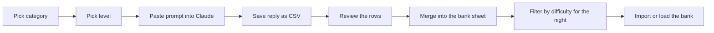

# OmniTrivia Question Generation Runbook

OmniTrivia writes its own questions with Claude at game setup, but a pre-generated library is better for a real night: you read every row before a room does, you keep the good ones, and you never pay for a question twice. This runbook is the workflow. The prompt itself lives in the repo at `QUESTION_PROMPT.md` so it stays in step with the app; this note is how and when to run it.

## The levels

The app pitches generated questions at one of three levels, and the prompt uses the same three. **High school is the default** and the one to use unless the room is unusual.

| Level | Who it is for | The test the model applies to every question |
| --- | --- | --- |
| **Everyday** | A family night, a mixed-age crowd, anyone who has had a few | Would a 12-year-old and their grandparent both know this instantly? |
| **High school** | The default: a bar crowd of friends, regulars and walk-ins | Would an average 17-year-old, and an adult who has not followed the subject since school, know this instantly without looking it up or working anything out? |
| **Pub quiz** | A room that came to compete | Mostly gettable, with at most one question in six that rewards somebody who knows the subject |

The brief names the reader, gives the model that test, and shows examples on both sides of the line. The too-hard examples are real questions from the first nights, so the model has seen exactly what not to write.


*One run per category per level. The sheet is the library; a night is a filter on it.*

## Where the prompt is

- **Repo:** `QUESTION_PROMPT.md` at the root of the OmniTrivia repository, on GitHub at `OmniFlexFitness/OmniTrivia`. Copy the fenced block under "The prompt".
- **Settings you change per run:** `CATEGORY`, `DIFFICULTY`, `QUESTIONS`, and `TYPED ANSWERS` (leave off; the app leaves typed rows out unless the switch at game setup is on).
- **Everything else stays.** The category notes, content rules, format rules and CSV rules are the same brief the app sends, so a pre-generated set plays at the same level as a generated one.

## Running it

1. **One category, one level, one run.** Paste the block into Claude with the three settings filled in. Twenty categories in one message gets one category's worth of attention spread over twenty.
2. **Ask for 20 to 30 questions.** Under 20 the format examples outweigh the content; over 30 the model repeats itself near the bottom. For 60 of a category, run it three times and paste the earlier questions in as an avoid-list.
3. **Save the reply as `questions-<category>-<level>.csv`**, for example `questions-science-school.csv`. The reply is the file; it needs no editing.
4. **Review it before it goes anywhere near a room.** Read the set as the room, not as the host. A row you would have to think about is a pub-quiz row that slipped into a high-school file: delete it or move it.
5. **Merge.** Paste every file into one tab of one Google Sheet under the same header. The last column, `difficulty`, is ignored by the game and exists so you can filter the sheet.

## Model and effort

| Where | Model | Thinking / effort | Notes |
| --- | --- | --- | --- |
| claude.ai on the Max plan | The newest Opus in the picker | Extended thinking on | No API cost. Opus holds the level and the format across 30 rows; Sonnet drifts harder and drops columns |
| Claude API, the app or the script | `claude-opus-5-5` | Adaptive thinking, effort `high` | The current Opus at the lower Opus price. `xhigh` and `max` buy nothing on trivia |
| A cheap bulk run to cut down | `claude-sonnet-5-5` | Effort `high` | Fine for Everyday; review High school sets from it more carefully |

- A 24-question run is a few cents at Opus rates. All 20 categories at all three levels is well under five dollars, inside the monthly API credit a Max plan includes once a Console organization is linked to it.
- With thinking on there is no temperature to turn; vary a set by varying the prompt (the count, or an avoid-list), not the sampling.
- Through the API, structured output beats a CSV instruction. The app's generator does this already (`src/services/claudeService.ts`), and the Node script runs the same brief with the same defaults:

```bash
npm run generate-questions -- --categories Science --difficulty school --out science-school.csv
```

The script knows the ten built-in categories. For the other ten in the category pool, use the prompt in claude.ai.

## Loading a night

| Source | How | Level control |
| --- | --- | --- |
| Your merged sheet as the bank | Share it as "anyone with the link can view" and point `DEFAULT_QUESTION_BANK` in `src/constants.ts` at it | Filter the sheet, or keep one tab per level and point at the tab |
| A CSV export | HOST GAME, IMPORT MY OWN QUESTIONS, Select File | Export only the rows whose `difficulty` matches the night |
| Generated on the spot | HOST GAME, GENERATE & REVIEW | The QUESTION DIFFICULTY picker on the setup screen, remembered on the device |

Either way the review screen comes next. It lists every round, marks the correct answer, and says how many rows were left out and why. The regenerate button on it rewrites one question at the night's difficulty setting in the same format, which beats regenerating a whole file to replace one weak row.

## Settings that affect what plays

- **Typed answers are off by default.** The TYPED ANSWERS switch at game setup turns them back on for everything: Claude is asked to write them, and typed rows in a file or the bank are kept. Closest-number and unscramble are not covered; a number is a keypad and a scramble is tiles.
- **Format mix.** Multiple choice and true/false are the backbone, about two thirds and one in five. The other formats together get at most one question in six and are written as the easiest questions in the set, because the format itself is the work.
- **Clocks.** Select-all, typed, slider, range and closest-number questions get 25 seconds, pin and unscramble 35, the order, match and sort puzzles 45, and any question over 80 characters earns reading time on top.

## Key Takeaways

- Pre-generate one category at one level per run, 20 to 30 questions, and save each reply as its own CSV.
- High school is the default level; the prompt carries a test the model applies to every question and examples of what is too hard.
- Use the newest Opus with thinking on in claude.ai, or `claude-opus-5-5` at effort `high` through the API; a whole library costs a few dollars.
- One sheet holds every level, the `difficulty` column is the filter, and the review screen is the last check before a room sees anything.
- Typed answers stay out unless the switch at game setup is on.
